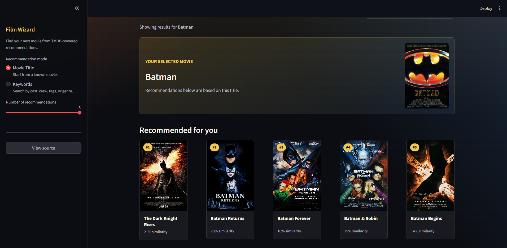

# Film Wizard

Film Wizard is a Streamlit movie recommendation app built from the TMDB 5000 movie dataset. It recommends films from either a selected movie title or a keyword search such as cast, crew, genre, mood, or tags.

The recommendation engine uses saved TF-IDF and cosine similarity artifacts, while the app fetches fresh poster and IMDb metadata from TMDB at runtime.

## Preview

### Home


### Sidebar



### Recommendations


## Features

- Movie-title recommendations based on cosine similarity.
- Keyword recommendations using the saved TF-IDF vectorizer.
- Runtime poster fetching from TMDB.
- Poster fallback handling through TMDB search, with a final placeholder if no poster exists.
- IMDb links when TMDB provides an IMDb ID.
- Cached model loading and API calls for smoother Streamlit interaction.
- Responsive, poster-focused UI with title search, keyword search, and result-count controls.

## Tech Stack

- Python
- Streamlit
- Pandas
- NumPy
- scikit-learn
- joblib
- requests
- BeautifulSoup

## Getting Started

### 1. Clone the Repository

```bash
git clone https://github.com/easyvansh/Film-Wizard.git
cd Film-Wizard
```

### 2. Create a Virtual Environment

Windows PowerShell:

```powershell
python -m venv .venv
.\.venv\Scripts\Activate.ps1
```

macOS/Linux:

```bash
python -m venv .venv
source .venv/bin/activate
```

### 3. Install Dependencies

```bash
pip install -r requirements.txt
```

### 4. Run the App

```bash
streamlit run app.py
```

The project includes `.streamlit/config.toml`, which sets the local Streamlit port to `400`.

Open the app at:

```text
http://localhost:400
```

If port `400` is already in use, Streamlit may print a different local URL in the terminal.

## Usage

1. Open the app in your browser.
2. Choose a recommendation mode in the sidebar.
3. Select a movie title or enter keywords.
4. Choose how many recommendations to show.
5. Click the recommendation button.
6. Click any poster card to open the movie page.

## Dataset and Model Artifacts

The raw dataset lives in `data/`:

- `data/tmdb_5000_movies.csv`: TMDB movie metadata such as titles, overviews, genres, keywords, release data, and IDs.
- `data/tmdb_5000_credits.csv`: Cast and crew records for the TMDB movies dataset.

The app loads prebuilt artifacts from `models/`:

- `models/movie_db.df`: Serialized Pandas dataframe used for movie lookup.
- `models/tfidf_mat.tf`: Serialized TF-IDF feature matrix.
- `models/vectorizer.tf`: Serialized TF-IDF vectorizer for keyword searches.
- `models/cos_mat.mt`: Serialized cosine similarity matrix for title-based recommendations.

`scikit-learn` is pinned in `requirements.txt` because the saved vectorizer was created with `scikit-learn 1.3.0`. Loading pickle/joblib model artifacts with a much newer version can produce compatibility warnings or incorrect results.

## Poster Fetching

Film Wizard uses multiple poster sources so movie cards do not break:

1. It requests movie details by TMDB ID and uses the TMDB poster when available.
2. If the detail response has no poster, it searches TMDB by movie title and uses the first available poster.
3. If TMDB does not return a usable poster, it asks IMDb's suggestion data for a matching title and uses the IMDb media image when available.
4. If suggestion data is unavailable, it tries the IMDb title page metadata as a final IMDb fallback.
5. If every external source fails or a remote image does not load in the browser, the UI falls back to a poster-shaped placeholder so every movie card still has an image area.

The app currently includes a fallback TMDB API key in `app.py`. For deployed or production usage, set your own key through an environment variable:

```bash
TMDB_API_KEY=your_key_here
```

On Windows PowerShell:

```powershell
$env:TMDB_API_KEY="your_key_here"
```

## Project Structure

```text
Film-Wizard/
|-- .streamlit/
|   `-- config.toml
|-- assets/
|   |-- Home Preview.png
|   |-- Search Results.png
|   `-- Sidebar.png
|-- data/
|   |-- tmdb_5000_credits.csv
|   `-- tmdb_5000_movies.csv
|-- models/
|   |-- cos_mat.mt
|   |-- movie_db.df
|   |-- tfidf_mat.tf
|   `-- vectorizer.tf
|-- notebook/
|   `-- Base.ipynb
|-- .gitattributes
|-- .gitignore
|-- app.py
|-- fetch_review.py
|-- imdb_id.py
|-- LICENSE
|-- README.md
|-- requirements.txt
`-- styles.css
```

## File Guide

- `.streamlit/config.toml`: Streamlit server configuration. The app port is set to `400`.
- `assets/`: Screenshots used in this README.
- `data/`: Raw TMDB CSV files used to build the recommendation data.
- `models/`: Serialized dataframe, vectorizer, TF-IDF matrix, and cosine similarity matrix loaded by the app.
- `notebook/Base.ipynb`: Notebook used for exploration, preprocessing, and model artifact generation.
- `.gitattributes`: Git repository attribute settings.
- `.gitignore`: Excludes local virtual environments, Python caches, editor files, secrets, logs, and build output.
- `app.py`: Main Streamlit app with UI, recommendation logic, poster fetching, and cached artifact loading.
- `fetch_review.py`: Experimental/helper script for IMDb review scraping utilities.
- `imdb_id.py`: Helper for resolving an IMDb movie URL from a title.
- `LICENSE`: Project license.
- `requirements.txt`: Python dependencies required to run the app.
- `styles.css`: Custom Streamlit styling for the app layout and movie cards.

## Notes for Contributors

- Do not commit `.venv/`, `__pycache__/`, local secrets, or editor folders.
- Keep the files in `models/` available unless you also update the app to regenerate them.
- If the model artifacts are rebuilt with a newer `scikit-learn`, update the version pin in `requirements.txt`.
- The app needs internet access to fetch posters and movie links from TMDB.

## License

This project is licensed under the terms in [LICENSE](LICENSE).

## Reference

[Understanding Key Concepts and the Science Behind Recommendation Engines while Crafting One from Scratch](https://ai.plainenglish.io/tmdb-streamlit-build-your-own-movie-recommendation-system-f2ffbca63d11)
